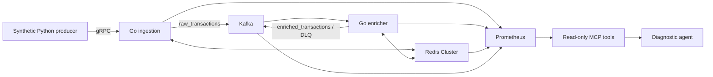

# Transaction pipeline diagnostic agent

This repository is a testbed for an **operational diagnostic agent**. A synthetic transaction producer feeds a Go and Kafka enrichment pipeline. Prometheus and five read-only MCP tools let an LLM inspect the running system. A fault harness tests whether the agent identifies an operational root cause and cites observations.

The V2 pipeline **does not run a fraud classification model**. Its `is_fraud` field comes from synthetic input. The old [README](docs/LEGACY_README.md) and [evaluation artifacts](eval/validity_report.md) are historical. In particular, the 9,152 TPS, 16.9 ms P99, exactly-once, and agent accuracy claims are not validated for this rebuilt version.

## Current status

| Area | Verified locally | Still needed |
| --- | --- | --- |
| Go services | Both Linux Docker images build from one root Go module | Failure/recovery and sustained load measurements |
| Traffic producer | Final simplified image loads the saved model with SDV 1.31.0 and creates a valid protobuf request | Measure its actual output rate on the isolated stack |
| Data path | Final images passed an isolated duplicate/invalid-input smoke test and a fresh-stack [100-request reconciliation](experiments/pipeline_reconciliation_100.json): 100 acknowledged, 100 raw, 100 enriched, 0 DLQ, no missing or duplicate output IDs | Sustained load and broker interruption tests |
| Redis and rate limit | Production Lua passed window, duplicate, expiry and token-bucket tests in isolated Redis containers | Throughput and memory profiling with skewed IP traffic |
| Agent | Deterministic graph and config tests pass; baseline calls count against budget; change ledger removed; prompts and tool schemas recorded | A real model pilot and human review of diagnoses |
| Experiments | Separate Compose project, clean-stack marker, four reversible pilot faults, healthy control and human-label scorer | RunPod endpoint, fault pilot, larger matrix and final analysis |

No new model evaluation or sustained throughput result has been collected. The 100-request check is a correctness probe, not a throughput benchmark. The [rebuild plan](PROJECT_REBUILD_PLAN.md) and [reliability audit](RELIABILITY_AUDIT.md) explain the gaps.

## System



The gRPC server acknowledges only after Kafka reports delivery. The enricher commits its source offset only after the enriched or dead-letter output is delivered. This provides **at-least-once** handling: retries can create duplicate Kafka records. Redis window updates are idempotent for a transaction ID on the same IP for seven days. Consumers of enriched records must deduplicate by transaction ID if they require unique results. The two-hour features use **processing time** and cost O(number of events for an IP in the window) per update.

See [architecture and claim map](docs/ARCHITECTURE.md) for code entry points and precise limits.

## Local checks

Docker Desktop is required. Copy `.env.example` to a local `.env` and fill in the `GEOIPUPDATE_*` credentials before starting GeoIP. Python requirements are under `agent/` and `mcp-server/`; use an environment that has `grpcio` for the smoke test.

```powershell
docker compose build go-server go-enricher python-producer
docker compose run --rm --no-deps --entrypoint go go-server test -tags musl ./go-server ./pb/... ./internal/...
docker compose run --rm --no-deps --entrypoint go go-enricher test -tags musl ./go-enricher ./pb/... ./internal/...
docker compose run --rm --no-deps --entrypoint python python-producer -c "from traffic import TransactionGenerator; r = TransactionGenerator(20261010).make_request(); assert r.transaction_id and r.user_id and r.amount >= 0"
python -m unittest tests.test_redis_window tests.test_rate_limit tests.test_agent_contract tests.test_v2_scoring -v
python -m unittest discover -s eval/semantic_eval/tests -t . -q
```

The agent graph contract test uses packages in `agent/requirements.txt`: `agent/venv/Scripts/python.exe -m unittest tests.test_agent_graph -v` on Windows. For a live smoke check, run `python -m experiments.stack build` once, then `python -m experiments.stack up`, and run `agent/venv/Scripts/python.exe -m tests.smoke_pipeline --experiment-stack` while `python-producer` is stopped. Remove only that isolated stack with `python -m experiments.stack down`. Do this in a separate stack session from a scored run, because smoke traffic makes the topics non-empty.

## New agent experiments

The [experiment protocol](docs/EXPERIMENT_PROTOCOL.md) defines validity and scoring. `experiments/runner.py` supports a healthy control and four sustained faults: stopped Redis node, paused ingestion, stopped Kafka broker and paused enricher. Scripts that call Redis `FLUSHALL` are excluded.

The experiment project uses a separate Compose name, subnet and host ports. It does not reset the old Kafka or Redis containers. Build its images once before the first run with `python -m experiments.stack build`; then reuse those exact images across runs. For **each** run, create a fresh isolated stack, initialize its empty-state marker before producer traffic, and check readiness:

```powershell
python -m experiments.stack up
python -m experiments.runner --init-stack
python -m experiments.stack start-traffic
python -m experiments.runner --preflight
```

Set `MODEL_BASE_URL` to an OpenAI-compatible `/v1` endpoint, `MODEL_ID`, and `MODEL_API_KEY` in your shell. Then run, for example:

```powershell
python -m experiments.runner --case redis_node_stopped --retrieval off
python -m experiments.stack down
```

New artifacts go to `experiments/runs/v2/`, separate from the historical `agent/traces` and `eval` results. The runner permits one scored run per fresh stack. A retrieval-on run additionally requires `CHROMA_DIR` pointing to an index built with the tested fault held out. Human-reviewed labels in `experiments/human_labels.csv` are summarized with `python -m experiments.score`. For separate pipeline correctness measurement, use `agent/venv/Scripts/python.exe -m experiments.pipeline_probe` on an empty isolated stack with the producer stopped. No model endpoint has been supplied yet, so no pilot run has been performed.

## Resume claims

Verified engineering work can be described now: a monitored Go/Kafka/Redis testbed, explicit at-least-once delivery behavior, an atomic two-hour feature window, and a diagnostic agent harness with saved evidence. Do not use throughput, latency, detection accuracy, or reliability percentages until the new experiments produce reproducible artifacts and human-reviewed results.
