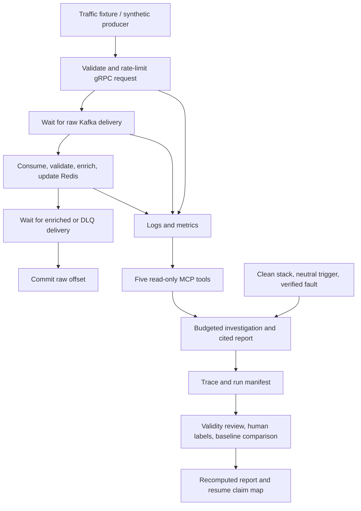

# Project completion plan

Status: proposed scope and acceptance gates, October 14, 2026, updated for the user's hard three-day limit and available RunPod RTX 3090 (24 GB VRAM). Planning only; no implementation or new experiment results are implied. This document builds on `PROJECT_REVIEW_2026-10-14.md`. It is the proposed execution checklist for the next iteration; `PROJECT_REBUILD_PLAN.md` remains historical planning context. Freeze the experiment protocol separately before collecting final results.

## Outcome

Deliver a complete, reproducible operational diagnostic-agent project that a new graduate can demonstrate, explain and defend. A reviewer should be able to start the system, reproduce a controlled incident, inspect the agent's observations and conclusion, and recompute the published evaluation from saved artifacts.

Working description: **Evidence-based incident diagnosis for a Go/Kafka/Redis transaction pipeline.** The pipeline is a real system under test. Its synthetic fraud labels do not establish fraud-classification capability.

Completeness means closing the contracts and evidence for a declared scope. It does not require diagnosing every possible incident, a high accuracy number, evaluating every model, or validating every historical injector. Resume statements will follow the final evidence. No accuracy, throughput, improvement or confidence target will be invented in advance.

## Scope decisions proposed

| Area | Decision |
| --- | --- |
| Pipeline | Keep the current Go/gRPC, Kafka, Redis and enrichment architecture; preserve its explicit at-least-once contract |
| Agent | One custom LangGraph agent, five read-only MCP tools, one fixed model configuration for the main experiment |
| Initial release | Four validated sustained faults across Redis, Kafka, network and client configuration, plus two controls; candidate set below |
| Comparisons | Adaptive agent versus a frozen scripted observation sweep followed by one diagnosis from the same model; a deterministic triage rule uses that scripted observation packet too |
| Retrieval | Off for the first completed release; retain as optional only if it gets a separate held-out experiment and adds a clear finding |
| Scoring | Human-reviewed diagnoses and evidence for the release population; LLM judging is auxiliary until checked against human labels |
| Simplification | Improve code needed for the supported flow; preserve useful modules and archive competing historical paths clearly |
| Deployment | Reproducible local Docker setup and CI; an external inference endpoint may be used and must be documented |

Production high availability, autonomous remediation, a real fraud classifier, an elaborate UI and a broad model leaderboard are outside this release's acceptance criteria. They are not prerequisites for demonstrating the intended AI engineering work.

## Inspect all three flows

Each row below is an inspection checkpoint. Mark it accepted only after attaching the required evidence. A source-level implementation, a passed fixture test and a live result are different evidence types.

| ID / stage | Current assessment | Acceptance criterion | Required evidence |
| --- | --- | --- | --- |
| I01 Setup and dependencies | Docker builds exist; dependencies float; V2 files are uncommitted; public Compose differs | One documented setup path works from a fresh checkout with declared prerequisites; experimental source/config/images are recoverable | Setup transcript, exact dependency versions, source snapshot or frozen commit, image IDs |
| I02 Input traffic | Saved SDV generator exists; suitable operational rate is unmeasured | Fixed traffic profile exercises repeated users/IPs; baseline conditions can replay the same workload; setup does not unnecessarily depend on heavy generation packages | Small replay fixture or verified seeded generator, workload manifest, measured delivered input rate |
| I03 Ingress | Validation, rate limiting and Kafka delivery acknowledgment exist | Invalid input is rejected; rate-limit behavior is correct; successful responses follow broker acknowledgment; deadline ambiguity is documented and reconciled | Focused service/integration checks, request IDs, acknowledgment outcomes and raw records |
| I04 Kafka delivery and offsets | Output-before-commit implementation exists; interruption behavior is untested | Broker interruption and consumer replay cause no silent loss under the declared recovery conditions; duplicate records are explicitly counted | Failure/recovery timelines and per-ID input/output/DLQ reconciliation |
| I05 Redis features and GeoIP | Atomic processing-time window has basic tests; replay/expiry limits exist | Window boundaries, shared-IP updates, duplicate scope and replay features have defined behavior; dependency failures are handled explicitly | Relevant behavior tests and a readable statement of state/replay limits |
| I06 Output and DLQ | Both code paths exist; saved healthy 100-request check exists | Malformed records reach DLQ and do not block subsequent valid records; both outputs are acknowledged before source offset commit | Poison-message and recovery scenarios, output IDs, offsets and DLQ reasons |
| I07 Observability | Instrumentation exists; duration bug and evidence truncation are confirmed | Metrics measure the stated boundary; fresh fault observations survive formatting/caps; scrape targets and exporter/backend health are distinguished | Metric timing check, busy-log regression check, target inventory and healthy/fault snapshots |
| I08 MCP boundary | Five read-only tools exist | Declared inputs, bounded outputs, timestamps, truncation and errors are consistent; callers use the intended Compose project | Tool contract checks and captured schemas/responses from the supported environment |
| I09 Agent control and reports | Budget/dedup/citation gate exists; confidence is a heuristic | Budget and retries terminate; duplicates/errors/parse failures are explicit; citations resolve; unknown causes can be reported honestly | Deterministic failure-path checks and live healthy/fault traces with cited reports |
| I10 Fault lifecycle | Four V2 mechanics checks are saved; wider catalog is uneven | Each selected fault has captured prior state, a proved live stimulus, observable effects, restoration and end-to-end recovery; no historical state residue | Fault acceptance sheet, before/during/after probes, restore transcript and reconciliation |
| I11 Evaluation | V2 runner and human scorer exist; no current agent population | Fixed comparable conditions, preserved attempts, independent labels, consistent report rules and recomputable metrics | Frozen protocol, manifests, traces, labels, baseline outputs and generated report |
| I12 Delivery and ownership | Documentation and CI exist but overlap and have gaps | Fresh setup/demo works; deterministic checks run in CI; the user can explain an incident and reproduce each published claim | Release README, demo instructions, actual CI results, claim map and walkthrough |

## Execution order and phase gates

### Phase 1 — Freeze the contract and the evidence ledger

Record the working tree as it exists before making changes. Choose the supported entry points, output schema, delivery semantics, evidence vocabulary and release scenarios. Keep historical results intact and explicitly separate. Resolve which configuration/build path is authoritative.

Create an evidence ledger with columns: checkpoint, concrete requirement, current finding, planned change, verification command, artifact, status. Statuses are not inspected, implemented, verified and accepted. Accepted requires a checked artifact, not just prose saying a feature is done.

**Exit gate:** every checkpoint has an acceptance criterion and a named verification artifact; scope and setup path are agreed. No model runs are needed yet.

### Phase 2 — Close pipeline and observation defects

Prioritize the incorrect request-duration measurement, newest-log truncation, incomplete service failure-path coverage, dependency pinning and stale status documentation. Verify the selected injectors against actual library/configuration behavior rather than their comments.

Check healthy traffic, invalid input, duplicate requests, Kafka delivery failure, a crash after output delivery but before offset commit, malformed Kafka input followed by valid input, and recovery after an interruption. Use fault hooks only where they are necessary to exercise a hard-to-reach boundary.

Reconcile IDs rather than only totals. A successful acknowledgment should eventually have its intended downstream result under the declared recovery conditions. A timed-out request may have reached Kafka; track that as an unknown delivery outcome rather than assuming it never existed. Duplicates are permissible under at-least-once delivery, but must be reported. Specify whether replayed records recompute features or reproduce a stored original result.

Keep the pipeline measurement separate from the agent benchmark. Any throughput claim additionally needs a sustained workload, raw measurement data, resource context, delivered output counts and clearly defined latency boundaries. Maximum-TPS tuning is not a completion gate.

**Exit gate:** the selected correctness/failure checks pass, recovery resumes end-to-end processing, and trustworthy observations remain visible to the agent. Fix behavior before collecting final agent results.

### Phase 3 — Close the agent contract

Exercise budget exhaustion, duplicates, unavailable tools, partial tool errors, long outputs, malformed model JSON, invalid citations, unsupported diagnoses, healthy conclusions and controlled timeouts. Distinguish tool attempts, logical model turns, actual inference attempts/retries, token usage and elapsed time in telemetry.

Keep the confidence rule modest and documented. Distinct tool names do not prove independent evidence or a correct cause. Measure unsupported and incorrect strong answers after the run; do not add another online LLM simply to make the word “confirmed” sound guaranteed.

Apply the same final-report and confidence rules to both model conditions. In particular, the current requirement for a model-requested observation cannot be used to handicap the nonadaptive baseline. Record evidence origin and adaptive investigation behavior separately from whether an observation can support a diagnosis.

**Exit gate:** deterministic control/error-path checks pass, one healthy and one live fault investigation finish with complete traces, and reports can be checked against their actual observations.

### Phase 4 — Validate the fault set and freeze the benchmark

The four core fault candidates are Redis master stopped, Kafka broker stopped, network latency and Redis client timeout misconfiguration. They cover both outages and degradation while containers remain running. Healthy and benign-change controls complete the core release. Enricher pause and Redis client-limit pressure are stretch cases; do not let them displace core verification or human review. The complete candidate inspection list is:

| Case | Why include it | What must be demonstrated before admission |
| --- | --- | --- |
| Redis master stopped | Cluster dependency failure and propagation | Node loss stays live; affected operations fail observably; state and processing recover |
| Kafka broker stopped | Distinguishes ingestion/output transport failure from Redis problems | Delivery outcomes and backlogs are observable; no silently missing acknowledged records after recovery |
| Enricher paused | Distinguishes accepted ingress from stalled downstream work | Raw traffic continues while enrichment stalls; lag grows and drains after restoration |
| Network latency | Investigates degradation without an explicit stopped container | Latency increases at a measured boundary while the container remains running; removal restores that boundary |
| Redis client timeout misconfiguration | Distinguishes client-side errors from a healthy dependency | The configured timeout has its intended effect and differs observably from a Redis outage |
| Redis client-limit pressure | Requires logs/config/metrics beyond basic container state | The limit is actually reached, connection failures occur, and the captured original configuration is restored |
| Healthy control | Tests whether a neutral trigger becomes a fabricated incident | End-to-end processing is healthy at the tested load |
| Benign traffic change | Tests whether any visible change is mistaken for a failure | Workload changes within measured capacity without violating the healthy contract |

At least two of the four core faults should require useful observations beyond a stopped/paused flag. If a candidate fails its mechanics or observability checks, repair or replace it before protocol freeze and document that choice. Run IDs and prompts must not encode the answer. Legitimate live logs/config are allowed; injector labels, answer-bearing ledgers and evaluator notes are not agent inputs.

All conditions receive the same tool definitions and output limits, equivalent fresh-stack initialization, matched traffic fixtures, model settings and total observation budget. A scripted sweep is fixed before seeing final results; it must not choose queries using the injected fault label. Its observations count against its budget. The deterministic rule and single-pass model may share that sweep's packet, with that access documented.

**Exit gate:** each case has an accepted mechanics/observability/recovery artifact; conditions, workload, labels, order randomization and reporting rules are frozen before final collection.

### Phase 5 — Pilot, measure capacity, then collect the final population

First run model-interface checks with controlled tool responses, then use healthy, Redis outage and network-latency cases once in each model condition: **six pilot investigations**. They test both collection paths and do not become the headline dataset. Check tool calling, context sizes, output parsing, current evidence, restoration, trace completeness and review effort. Measure runtime, tokens and actual inference cost before scheduling the final matrix.

Proposed main matrix: four faults plus two controls, three repetitions, two model conditions = **36 model-based investigations**. These are not 36 API calls: the adaptive agent uses multiple calls per investigation. If the measured runtime and review workload do not fit the remaining deadline, declare two repetitions (24 investigations) before freezing the main protocol. Do not reduce or select the population based on whether answers were correct. The deterministic baseline can be scored from the fixed-sweep packets without additional inference. Freeze workload variants and randomize condition order; document what a repetition changes. A seed does not guarantee identical hosted-model responses.

Every final diagnosis and its cited evidence receives human review. Prepare review packets that hide condition/model identity and confidence when scoring correctness where practical; supply ground truth to the correctness reviewer. Evidence support is a separate question checked against actual outputs. The user is the human reviewer; assistant suggestions and LLM labels must not be presented as independent human labels. A second reviewer on a subset is useful if available, but is not assumed.

Report fault accuracy, wrong answers, abstentions, control false alarms, insufficient-evidence responses, unsupported diagnoses, incorrect-among-confirmed, completion/validity rate, tool errors and duplicates, latency, actual token use and cost where measured. Publish per-case counts and exploratory uncertainty; repeated trials on four fault types do not establish general reliability. Keep primary diagnostic quality separate from failure-to-complete and invalid-attempt rates, so filtering invalid runs cannot hide operational fragility.

All planned attempts remain visible. Do not rerun wrong diagnoses until they become correct. A discovered harness defect requires a new protocol/version and a declared rerun of affected matched blocks. Report whether the agent beats, matches or underperforms each baseline. If there is no benefit, explain the failure and make any subsequent improvement a separately evaluated revision.

If using an LLM judge, compare it with the human labels and report disagreements. An LLM judge is optional for this small completed population; building a larger judge framework is not a substitute for reviewing the answers.

**Exit gate:** the frozen population is accounted for, labels and evidence are reviewed, baseline comparisons are computed, and a report can be regenerated without model access.

### Phase 6 — Package and demonstrate the release

Provide one entry-point README, architecture/data-flow explanation, setup/prerequisites, a healthy demo, a fault-and-recovery demo, limitations, and a clear route to the evaluated agent. Keep preserved historical code/results outside the default narrative. Verify the actual CI result rather than only adding a workflow file.

Archive a bounded, shareable evidence bundle: source/configuration identity, exact prompts/tool schemas, traces, manifests, human labels, analysis and results. Ensure required evidence is deliberately included despite the local run-directory ignore rules. Use synthetic data and omit credentials. The release must let someone regenerate tables from artifacts without paying to rerun the model.

Create a claim map: resume statement -> implementation -> verification -> experiment/result -> limitation. A count of files or tests is not automatically a compelling result. Prefer three complementary bullets: the diagnostic system, the controlled evaluation and its measured finding, and a concrete correctness/recovery result when available.

After every phase, walk through the changed flow with the user: what happens, why it is designed that way, how it fails and what proves the stated behavior. The final ownership check is explaining one complete transaction and one complete investigation, then making and verifying a small change without relying on memorized documentation.

**Exit gate:** a reviewer can reproduce the demo and analysis, all stated limitations are visible, and each final resume bullet has evidence the user can explain.

## Confirmed constraints and three-day schedule

The user confirmed that three days is a hard limit: maximize verified completeness within that time. They can provide a RunPod RTX 3090 with 24 GB VRAM for model inference. An active endpoint, its availability window and an hourly cost ceiling have not yet been provided. Do not create or rent resources from this planning update.

| Day | Work and exit evidence |
| --- | --- |
| Day 1 | Close the source/setup contract, repair core pipeline/observation defects, run focused correctness checks, and perform early model-interface compatibility checks once the endpoint is available. Exit with trustworthy observations and one complete healthy/fault trace. |
| Day 2 | Admit the four core faults and controls, verify restoration and resumed processing, finish the fixed-sweep baseline, run the six-investigation pilot, and freeze the main population based on measured runtime and review capacity. Begin main collection if ready. |
| Day 3 | Finish the frozen collection, review every final diagnosis and its cited evidence, recompute the baseline comparisons, verify the setup/demo, and package the report, limitations and resume claim map. Reserve time for the user's walkthrough. |

Endpoint compatibility should be checked on Day 1 so a model-serving problem is not discovered at the end. The schedule is a work allocation, not a guarantee that all defects or experiments will fit. If a fundamental acceptance gate remains unmet, report it as open and describe the verified scope accurately. Reduce stretch work and experiment breadth first; retain correctness checks, review and saved evidence.

## RunPod inference plan

Keep the Docker pipeline, MCP tools, experiment runner and agent on the local machine if the existing machine can run them consistently. Use RunPod as an inference service. The agent sends model requests to the hosted endpoint and executes the selected tools locally; the model server does not need direct access to local Docker or Redis.

Start with one quantized, tool-capable model in the roughly 8B class, one active inference request at a time, and a context limit measured against the full system prompt, tool schemas, evidence and output allowance. `Qwen/Qwen3-8B-AWQ` is a pilot candidate, not a frozen selection or a guarantee of diagnosis quality. Its official model card documents 4-bit quantization and serving support; Qwen documents vLLM function calling. A 24 GB fit with the selected context/runtime settings is an engineering estimate to verify on the actual GPU.

References checked for this plan: [official model card](https://huggingface.co/Qwen/Qwen3-8B-AWQ), [Qwen vLLM deployment](https://qwen.readthedocs.io/en/stable/deployment/vllm.html), and [vLLM tool calling](https://docs.vllm.ai/en/stable/features/tool_calling/).

Use an endpoint compatible with the agent's existing `/v1` interface. Pin the accepted model revision, quantization, serving version, chat template, tool parser, reasoning-mode setting, context length and inference parameters before final collection. Check that the current client's Qwen-specific `reasoning_effort` argument is accepted and has the intended effect; do not assume it works with every backend. Reject silent context truncation and unparseable tool responses during admission checks. Memory fit alone does not establish tool-calling reliability.

Use the same pinned model for both model conditions. A multi-model leaderboard and retrieval ablation are stretch work outside the three-day core. Record GPU active time and measured cost if pricing is supplied; benchmark latency includes network and local tool time unless a separate inference-only measurement is explicitly reported.

The immediate next implementation work would be Phases 1 and 2. This planning update does not start refactoring, operate project faults or spend inference credits.
